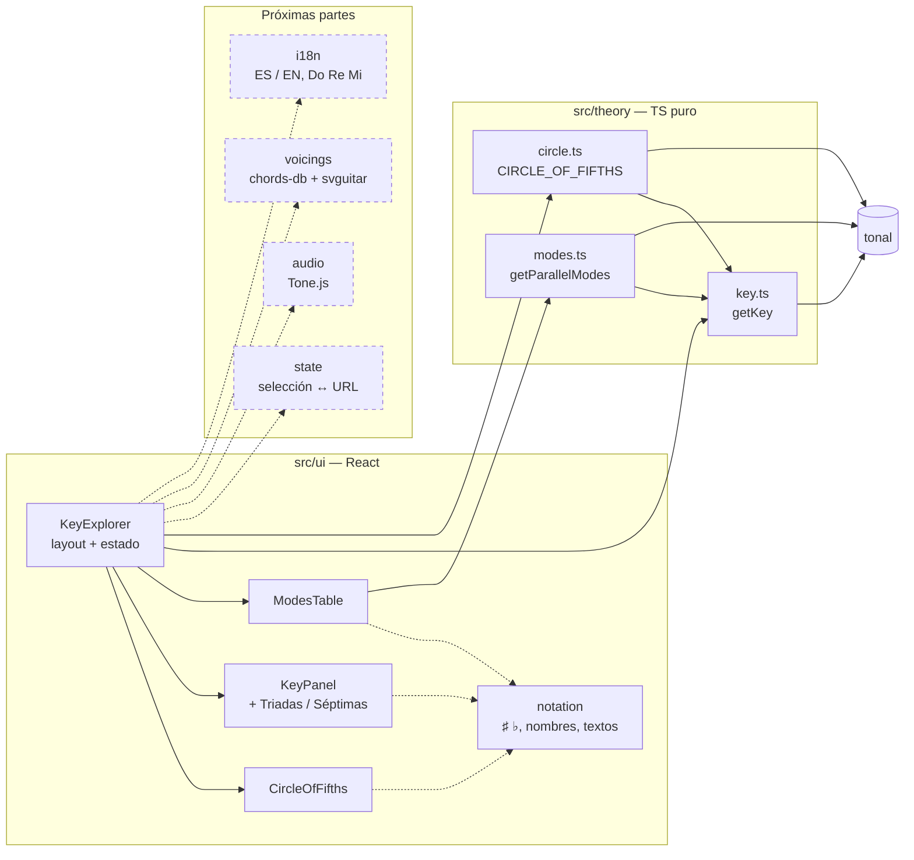
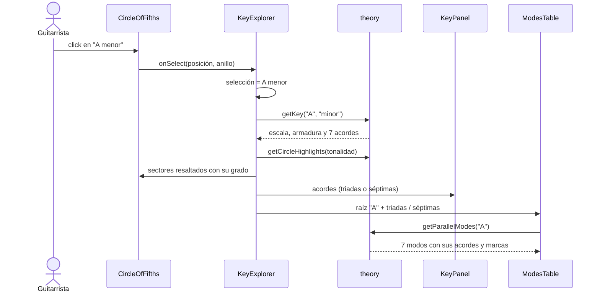

# Círculo de Quintas para guitarra

Web interactiva para componer en guitarra. Haces click en una tonalidad del círculo de quintas y se
marcan sus acordes, con grados y calidades (mayor, menor, disminuido). Al lado aparece una tabla con
los 7 modos de la raíz para hacer intercambio modal, con los acordes representativos de cada modo,
los diagramas en la guitarra y el sonido de cada acorde.

## Estado

🚧 **En desarrollo.** La v1 se construye por partes; ya funcionan el círculo, el interruptor
Triadas / Séptimas y la tabla de modos paralelos.

| Versión | Alcance | Estado |
|---|---|---|
| v1 | Círculo interactivo (triadas/séptimas), tabla de los 7 modos con acordes recomendados, diagramas de acordes, audio al hacer click, ES/EN, C D E / Do Re Mi | 🚧 En curso (5 de 9 partes) |
| v2 | Modos de menor armónica y melódica, extensiones (9/11/13, sus, add), armador de progresiones | 💡 Idea |
| v3 | Despliegue y backend para guardar progresiones | 💡 Idea |

## Funcionalidades (v1)

- ✅ **Círculo de quintas**: mayores afuera y menores relativas adentro. Al seleccionar una
  tonalidad se resaltan sus 7 acordes diatónicos con número romano y calidad. Las tonalidades
  enarmónicas (F♯/G♭, C♯/D♭, B/C♭) muestran los dos nombres y se puede cambiar de grafía.
- ✅ **Triadas / Séptimas**: el panel de la tonalidad y la tabla de modos muestran triadas o
  acordes de séptima (maj7, m7, 7, m7♭5).
- ✅ **Tabla de modos paralelos** (jónico… locrio) de la raíz seleccionada: escala, nota
  característica y grados alterados (♭II, ♯iv°, ♭VII). Se marcan los acordes que contienen la nota
  característica, los prestados del jónico y ⭐ el más representativo.
- ⏳ **Panel de acorde**: notas, ▶ para escucharlo, diagrama en la guitarra y en qué modos aparece.
- ⏳ Interruptores **C D E / Do Re Mi** e idioma **ES / EN**.
- ⏳ La selección queda en la URL, así que se puede guardar en favoritos o compartir.

## Arquitectura

Sitio 100 % estático. El código se organiza en módulos con una interfaz chica y la lógica adentro.
La teoría musical vive en `src/theory/`, TypeScript puro sin React, y es la única parte que habla
con `tonal`. La UI no hace cuentas musicales: solo pide datos a `theory` y los presenta.



Regla de dependencias: `ui` puede usar `state`, `theory`, `voicings`, `audio` e `i18n`; `theory`
no importa nada del proyecto, solo `tonal`.

Qué pasa al hacer click en una tonalidad del círculo:



La corrección musical se prueba contra un **oracle escrito a mano** (nunca contra `tonal`, que
sería circular) más invariantes sobre todas las tonalidades del círculo.

## Stack

TypeScript · React · Vite · [tonal](https://github.com/tonaljs/tonal) (teoría) ·
[Tone.js](https://tonejs.github.io/) (audio) · [svguitar](https://www.npmjs.com/package/svguitar)
(diagramas) · Vitest · Testing Library · Playwright

## Desarrollo

Requiere Node.js ≥ 22.12.

```bash
npm install          # instalar dependencias
npm run dev          # servidor local en http://localhost:5173
npm test             # tests (Vitest)
npm run lint         # oxlint + chequeo de tipos
npm run build        # build de producción en dist/
```

## Licencia

MIT
