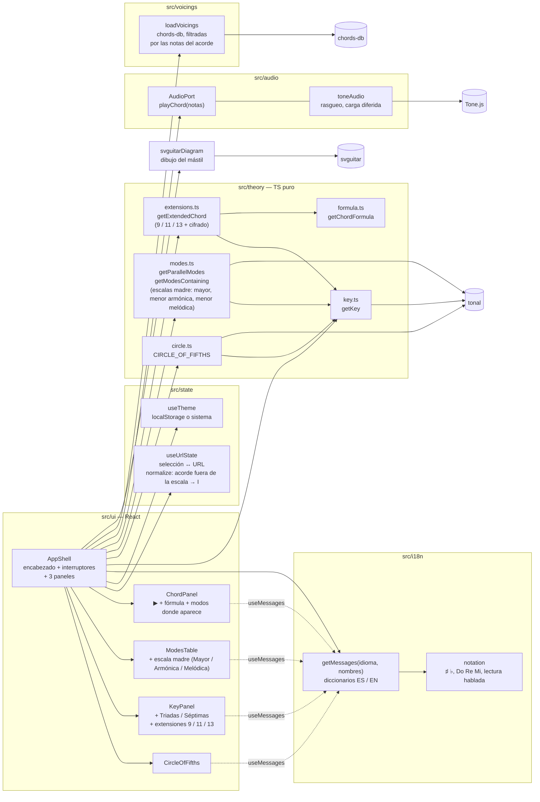
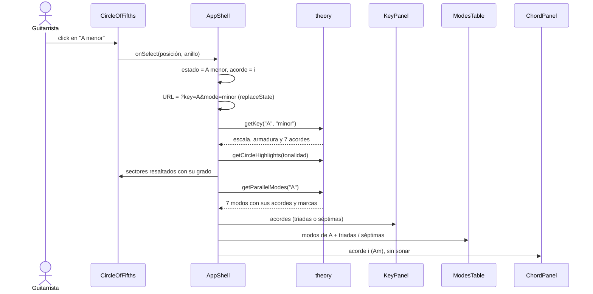

# Círculo de Quintas para guitarra

Web interactiva para componer en guitarra. Haces click en una tonalidad del círculo de quintas y se
marcan sus acordes, con grados y calidades (mayor, menor, disminuido). Al lado aparece una tabla con
los 7 modos de la raíz para hacer intercambio modal, con los acordes representativos de cada modo,
los diagramas en la guitarra y el sonido de cada acorde.

## Estado

✅ **v1 completa.** Funcionan el círculo, el interruptor Triadas / Séptimas, la tabla de modos
paralelos, el panel de acorde con sonido y diagrama en la guitarra, la interfaz en español e
inglés, los nombres Do Re Mi, el tema claro / oscuro y la selección guardada en la URL; se usa con
teclado y lector de pantalla, y en el celular. Tests de punta a punta con Playwright.

✅ **v2.1 extensiones.** Al acorde abierto se le pueden sumar hasta dos de 9, 11 y 13, tomadas de
la escala de la tonalidad o del modo (♭9, ♯11 y ♭13 donde corresponde), con cifrado, fórmula,
diagrama y sonido.

🚧 **v2.0 menor armónica y melódica (en curso).** La tabla de modos ya muestra los 7 modos de la
escala mayor, la menor armónica o la menor melódica, con selector, acordes aumentados, mMaj7 y °7;
falta el cierre (pruebas sobre las 24 raíces).

| Versión | Alcance | Estado |
|---|---|---|
| v1 | Círculo interactivo (triadas/séptimas), tabla de los 7 modos con acordes recomendados, diagramas de acordes, audio al hacer click, ES/EN, C D E / Do Re Mi, accesibilidad y celular | ✅ Completa |
| v1.5 | Publicación en Vercel con CI como portero y headers de seguridad | ✅ Completa |
| v1.6 | Créditos al pie: autor, código en GitHub e Instagram | ✅ Completa |
| v1.7 | Fórmula del acorde: tabla con los grados (1, 3, 5…) y las notas del acorde seleccionado | ✅ Completa |
| v2.1 | Extensiones: hasta dos de 9, 11 y 13 sobre la triada o la séptima, con cifrado, fórmula, diagrama y sonido | ✅ Completa |
| v2.0 | Modos de menor armónica y melódica: selector de escala madre sobre la tabla de modos, acordes aumentados, mMaj7 y °7 con sus extensiones | 🚧 En curso |
| v2.2 | Armador de progresiones | 💡 Idea |
| v3 | Backend para guardar progresiones | 💡 Idea |

## Funcionalidades

- ✅ **Círculo de quintas**: mayores afuera, menores relativas en el medio y el acorde
  disminuido (vii°) en el anillo interior. Al seleccionar una
  tonalidad se resaltan sus 7 acordes diatónicos con número romano y calidad. Las tonalidades
  enarmónicas (F♯/G♭, C♯/D♭, B/C♭) muestran los dos nombres y se puede cambiar de grafía.
- ✅ **Triadas / Séptimas**: el panel de la tonalidad y la tabla de modos muestran triadas o
  acordes de séptima (maj7, m7, 7, m7♭5).
- ✅ **Extensiones 9 / 11 / 13** (al lado de Triadas / Séptimas): hasta dos sobre la triada o la
  séptima del acorde abierto, diatónicas a la tonalidad o al modo de donde salió (`Cadd9`, `C6/9`,
  `Dm11`, `G13`, `Fmaj7(♯11)`, `Em7(♭9)`). Cambian el cifrado, la fórmula, el diagrama (o avisan
  que no hay), el sonido y los modos donde aparece; se mantienen al cambiar de acorde o de
  tonalidad.
- ✅ **Tabla de modos paralelos** (jónico… locrio) de la raíz seleccionada: escala, nota
  característica y grados alterados (♭II, ♯iv°, ♭VII). Se marcan los acordes que contienen la nota
  característica, los prestados del jónico, ⭐ el más representativo y la fila de tu tonalidad. En
  el celular el nombre del modo queda fijo al desplazar la tabla.
- ✅ **Escala madre: Mayor / Armónica / Melódica** (arriba de la tabla de modos): cambia la tabla
  por los 7 modos de la menor armónica (menor armónica, locrio ♮6, jónico ♯5, dórico ♯4, frigio
  dominante, lidio ♯2, superlocrio ♭♭7) o de la menor melódica (menor melódica, dórico ♭2, lidio
  aumentado, lidio dominante, mixolidio ♭6, locrio ♮2, alterado) de la misma raíz, con sus acordes
  aumentados, mMaj7 y °7. En una
  tonalidad menor, el atajo "V7 y vii°7 → menor armónica" lleva directo ahí.
- ✅ **Panel de acorde**: al hacer click en un acorde (panel de tonalidad o tabla de modos) suena
  como un rasgueo y muestra grado, la fórmula (tabla de grados `1 ♭3 5` sobre sus notas), ▶ para
  repetirlo y en qué modos aparece (de las tres escalas madre, con la escala de cada uno).
- ✅ **Diagramas en la guitarra** del acorde (trastes, dedos, cejilla, cuerdas al aire y
  silenciadas), con 4 posiciones por acorde para recorrer con ◀ ▶.
- ✅ **Idioma ES / EN** (español por defecto): se traduce todo, incluidos los modos, las calidades
  y lo que anuncia el lector de pantalla.
- ✅ **C D E / Do Re Mi** (C D E por defecto), independiente del idioma: cambia los nombres de las
  notas en toda la app y deja los sufijos de acorde como están (`Fa♯m7`).
- ✅ **Tema claro / oscuro**: sigue al del sistema hasta que elijas uno, y lo recuerda.
- ✅ **La selección queda en la URL** (tonalidad, Triadas / Séptimas, extensiones, escala madre,
  acorde abierto, idioma y nombres de notas), así que se puede guardar en favoritos o compartir. Por ejemplo,
  `?key=G&mode=minor&chords=7th&chord=dorian.4&ext=9` abre G menor con séptimas y el IV7 de G
  dórico con su 9ª (`C9`).
- ✅ **Accesible**: todo se usa con teclado (flechas en el círculo), el lector de pantalla anuncia
  cada tonalidad con su armadura y cada acorde con su grado, la calidad no depende solo del color y
  el contraste cumple WCAG 2.1 AA en los dos temas (auditado con axe; el texto del círculo, que axe
  no mide en SVG, con un test propio). En el celular los paneles se apilan sin scroll horizontal,
  incluso a 320 px.

## Arquitectura

Sitio 100 % estático. El código se organiza en módulos con una interfaz chica y la lógica adentro.
La teoría musical vive en `src/theory/`, TypeScript puro sin React, y es la única parte que habla
con `tonal`. La UI no hace cuentas musicales: solo pide datos a `theory` y los presenta.



Regla de dependencias: `ui` puede usar `state`, `theory`, `voicings`, `audio` e `i18n`; `theory`
no importa nada del proyecto, solo `tonal`.

Qué pasa al hacer click en una tonalidad del círculo:



La corrección musical se prueba contra un **oracle escrito a mano** (nunca contra `tonal`, que
sería circular) más invariantes sobre todas las tonalidades del círculo.

## Stack

TypeScript · React · Vite · [tonal](https://github.com/tonaljs/tonal) (teoría) ·
[Tone.js](https://tonejs.github.io/) (audio) · [svguitar](https://www.npmjs.com/package/svguitar)
(diagramas) · Vitest · Testing Library · Playwright

## Desarrollo

Requiere Node.js 22 (≥ 22.22.2; ver `.nvmrc`).

```bash
npm install          # instalar dependencias
npm run dev          # servidor local en http://localhost:5173
npm test             # tests (Vitest)
npx playwright install chromium   # una sola vez, para los tests de punta a punta
npm run test:e2e     # tests de punta a punta (Playwright: escritorio y celular)
npm run lint         # oxlint + chequeo de tipos
npm run build        # build de producción en dist/
```

## Despliegue y seguridad

El sitio es estático y se publica en Vercel desde `main`. `main` solo recibe pull requests con el
CI de GitHub Actions en verde (`.github/workflows/ci.yml`: formato, lint, tests, `npm audit` y
E2E), así que a producción solo llega código verificado. No hay backend, cuentas ni secretos.

- **Headers de seguridad** en `vercel.json`: CSP estricta (sin `unsafe-inline` ni `unsafe-eval`;
  el único script inline va por hash), `nosniff`, `frame-ancestors 'none'`, `Referrer-Policy`,
  `Permissions-Policy`, HSTS. `vite preview` sirve los mismos, y los E2E verifican que la carga,
  el audio y los diagramas funcionan bajo esa política sin violaciones.
- **Entradas validadas**: la URL y el tema guardado en el navegador son las únicas entradas, y
  cada valor se valida contra una lista cerrada; cualquier otra cosa vuelve a su valor por defecto.
- **Dependencias** fijadas por el lockfile (`npm ci`), auditadas todas en el CI y actualizadas por
  Dependabot (solo versiones con más de dos semanas, salvo parches de seguridad). Las actions de
  GitHub están fijadas por commit.

## Licencia

MIT
